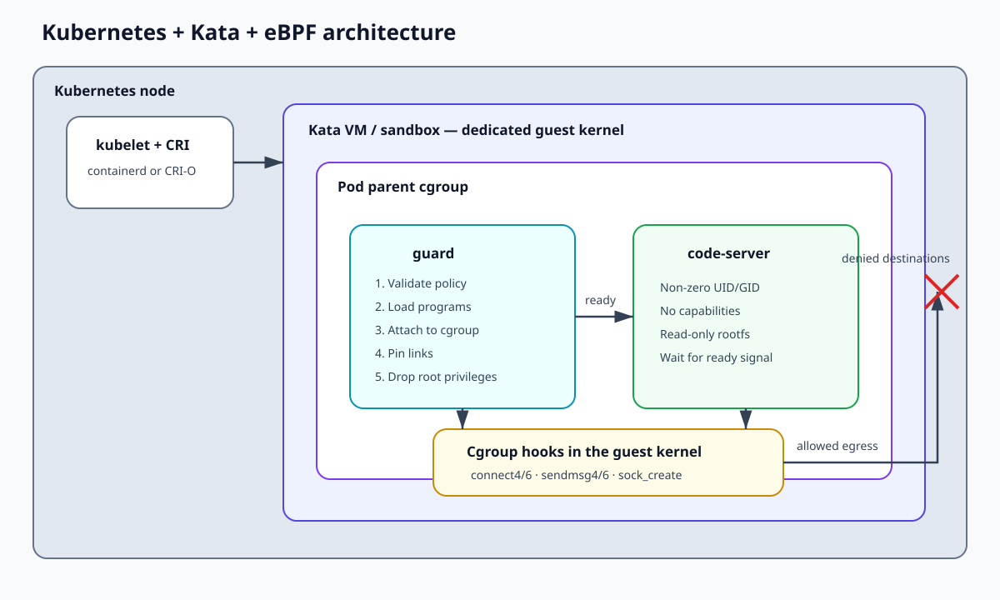
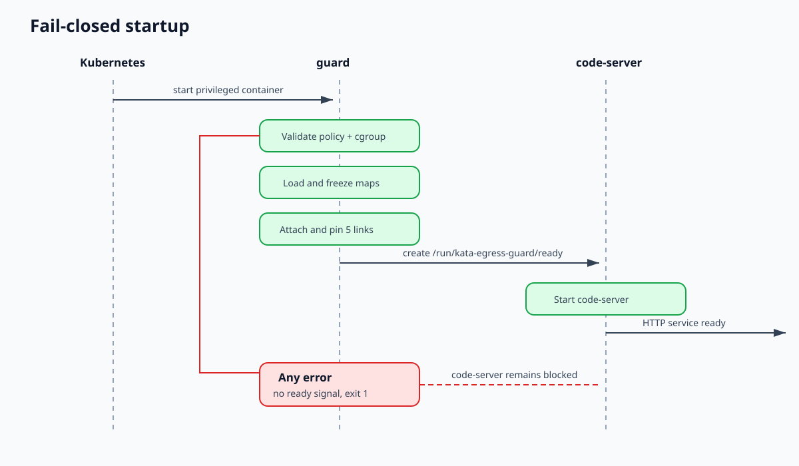

# Architecture

## Overview

Kata Containers creates a virtual machine for each Kubernetes sandbox. The eBPF
program is therefore loaded into the VM's **guest kernel**, not into the
Kubernetes node kernel.



The Pod contains two containers:

- `guard` starts with the privileges required inside the guest, discovers the
  Pod parent cgroup, loads the policy, attaches the eBPF programs, and then
  permanently drops its process privileges;
- `code-server` runs with a non-zero UID/GID, no Linux capabilities,
  `allowPrivilegeEscalation: false`, `RuntimeDefault` seccomp, and a read-only
  root filesystem.

The Helm-generated `NetworkPolicy` mirrors the allowlist at the CNI layer. It is
a second barrier, while in-guest eBPF remains the authoritative enforcement
mechanism.

## eBPF hooks

| Cgroup hook | Controlled traffic | Address family |
|---|---|---|
| `connect4` | Connected TCP and UDP | IPv4 |
| `connect6` | Connected TCP and UDP | IPv6 |
| `sendmsg4` | Unconnected UDP, checked per destination | IPv4 |
| `sendmsg6` | Unconnected UDP, checked per destination | IPv6 |
| `sock_create` | Denies Internet protocols other than TCP/UDP | IPv4/IPv6 |

Replies on a TCP connection accepted by code-server do not trigger another
`connect` operation. They therefore continue to work without adding user
addresses to the allowlist.

## Maps and rules

Two `BPF_MAP_TYPE_LPM_TRIE` maps store IPv4 and IPv6 destinations. The fixed
part of each key contains the protocol and port, followed by the CIDR prefix. A
rule therefore represents this exact tuple:

```text
protocol + destination port + CIDR prefix
```

Policy maps are frozen before attachment. Counters use a separate per-CPU map
to reduce contention.

## Startup



The shared `/run/kata-egress-guard/ready` file is created only after all five
attachments succeed. The code-server command waits for this file before
starting the service. Policy parsing, cgroup discovery, BPF verification, or
attachment failures therefore prevent the workload from starting.

Changing `policy.egress` changes the Pod template checksum. The rollout creates
a new Kata VM with the new policy; existing Pods retain their frozen policy
until termination.
