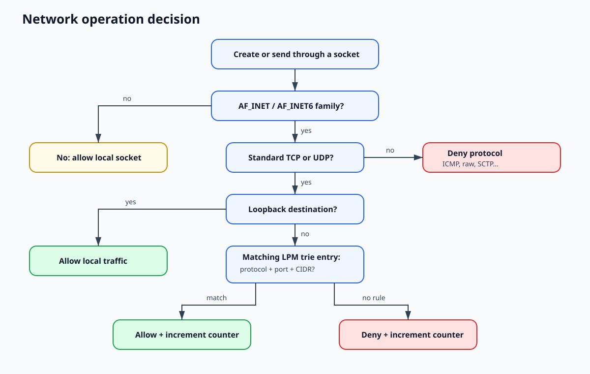

# Security model

## Goal

Prevent code running in code-server from initiating an IPv4 or IPv6 Internet
communication that does not match an explicit `CIDR + protocol + port` rule.

## Guarantees

- TCP and UDP are denied by default for undeclared destinations.
- ICMP, ICMPv6, SCTP, and raw Internet sockets are denied.
- IPv4 and IPv6 use separate allowlists; an IPv4 rule does not authorize an
  IPv4-mapped IPv6 address.
- Unix sockets and loopback remain available for local communication and probes.
- The policy covers the entire Pod cgroup, not only the code-server process.
- A missing prerequisite or ambiguous cgroup causes a fail-closed error.
- DNS and the Kubernetes API receive no implicit exceptions.

## Trust boundaries

The `guard` container is privileged inside the Kata guest during installation.
The Kata runtime must use `privileged_without_host_devices=true` to prevent node
devices from being passed through. After attachment, the agent enables
`no_new_privs`, removes supplementary groups, and changes to UID/GID 65532.

The code-server container receives neither a ServiceAccount token nor Linux
capabilities. The Pod also disables automatic Kubernetes Service environment
variables.

## Known limitations

- The policy controls initiated connections and UDP destinations, not every
  response packet on an accepted connection.
- DNS names are not stable identities and are not accepted in policy. Their
  resulting addresses must be managed explicitly.
- Protection depends on cgroup BPF hooks in the guest kernel. BPF support on the
  Kubernetes node alone is insufficient.
- `NetworkPolicy` enforcement depends on the CNI and does not replace guest eBPF.
- A restarting agent refuses to remove an existing pin directory. Recreate the
  Pod to avoid an enforcement gap.
- Network isolation does not replace image, storage, authentication, or Ingress
  hardening.

## Out-of-scope threats

- compromise of the Kata guest kernel;
- compromise of the runtime, hypervisor, or Kubernetes node;
- exfiltration through a non-IP channel explicitly exposed to the Pod;
- traffic to a compromised service already present in the allowlist;
- application-layer content inspection inside an allowed connection.
